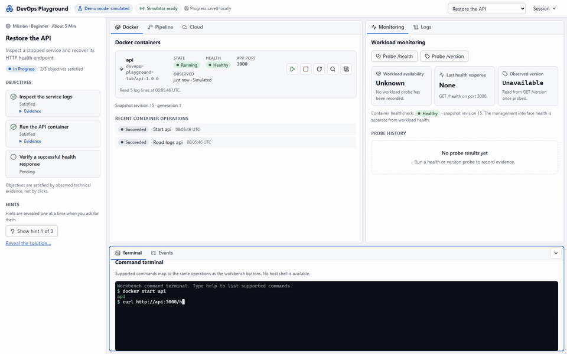
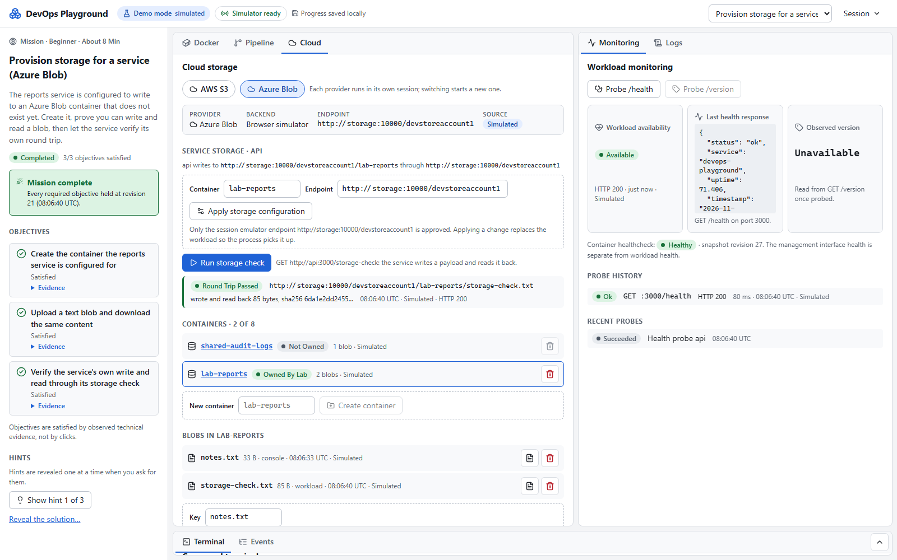
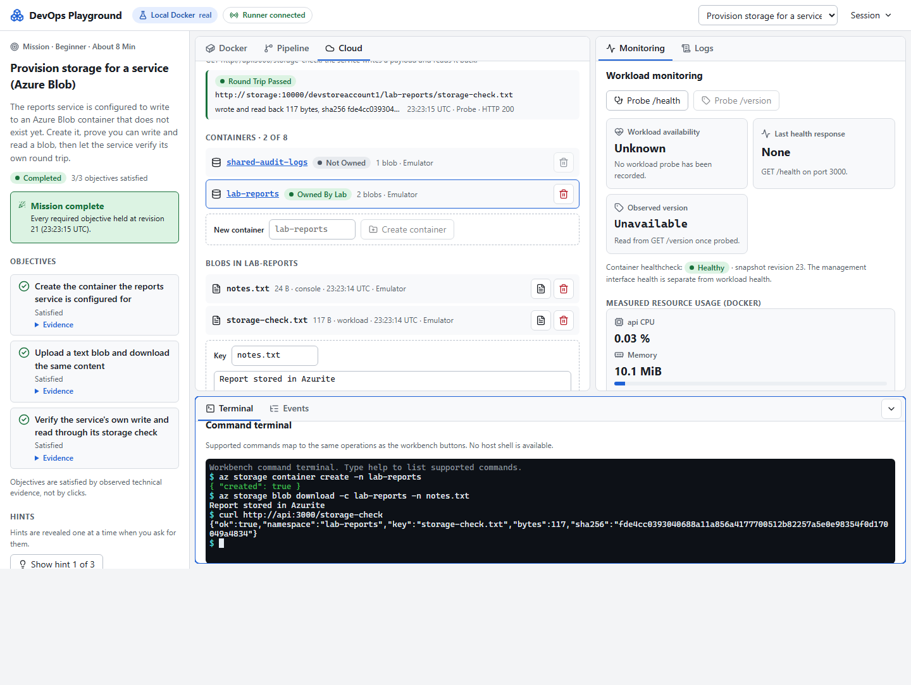
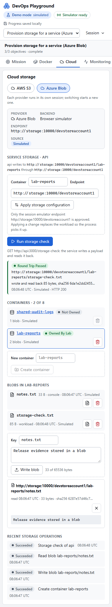
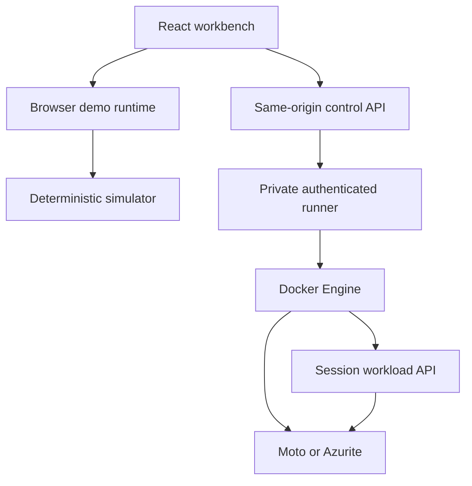

<p align="center">
  
</p>

<h1 align="center">DevOps Playground</h1>

<p align="center">
  <strong>Deploy. Diagnose. Recover.</strong><br>
  An interactive workbench for learning DevOps by operating a small API.
</p>

<p align="center">
  <a href="https://github.com/Nadjide/devops-playground/actions/workflows/ci.yml"></a>
  
  
  
  
  
</p>

<p align="center">
  <a href="#demo">Demo</a> &middot;
  <a href="#quickstart">Quickstart</a> &middot;
  <a href="#missions">Missions</a> &middot;
  <a href="#inside-the-workbench">Screenshots</a> &middot;
  <a href="#architecture">Architecture</a> &middot;
  <a href="#tests-and-cicd">Tests &amp; CI</a>
</p>

Start with a stopped service, a bad configuration, or a broken release. Read
the logs, repair the incident, and prove recovery through fresh health and
version checks. Docker, terminal, pipeline, cloud storage, and monitoring
panels stay connected to the same session.

**Two execution modes.** Explore a labeled browser simulation, or run real
Docker workloads on your machine. Local S3 and Azure Blob labs use Moto and
Azurite; no cloud account or paid cloud service is required.

## Demo

<p align="center">
  <a href="docs/demo/devops-playground.mp4?raw=1"></a>
</p>

**[Download the full walkthrough](docs/demo/devops-playground.mp4?raw=1)**
(MP4, 1 min 04 s, 3 MB), with chapters for API recovery, the pipeline, S3, and Azure Blob.

Recorded in the running **browser simulator**, with simulation labels visible.
The GIF contains four short excerpts; the video preserves actual interaction
speed. Real Docker evidence appears separately below.
[Recording details and regeneration](docs/presentation/README.md).

There is no hosted demo. Both modes can be run from a clone.

## What This Project Demonstrates

| Skill | Inspectable implementation |
| --- | --- |
| Containerization | Non-root workloads, limits, internal networks, healthchecks, scoped cleanup |
| CI/CD | Actual tests, image build, deploy, verification, and rollback in Local Docker mode |
| Full Stack engineering | React workbench, Express control API, live events, shared domain model |
| Cloud integration | Provider-specific S3 and Blob operations against real local emulators |
| Automated testing | API, domain, component, Docker integration, and browser suites |
| Operational boundaries | Observation provenance, ownership checks, bounded commands, same-origin and CSRF protection |

## Quickstart

Use **Node.js 22.22.2+** on the Node 22 line, or a compatible newer LTS release
(see [`engines.node`](package.json)). Packaged modes also need Docker Desktop
or Docker Engine with Compose and Linux containers.

```bash
git clone https://github.com/Nadjide/devops-playground.git
cd devops-playground
npm ci
```

### Run Locally

The browser demo needs no Docker or backend.

```bash
npm run dev:playground
```

Open the URL printed by Vite, normally **http://127.0.0.1:5173**.

### Run With Docker Compose

Operate real containers at **http://127.0.0.1:3001**. The first start builds the
portal and runner images.

```bash
npm run playground:local
npm run playground:status    # inspect the stack and owned resources
npm run playground:down      # end sessions and remove their owned resources
```

**Local use only.** The runner controls your Docker daemon through its socket.
Use a trusted personal machine; this is not a public multi-user sandbox.

<details>
<summary><strong>Packaged demo, another port, and cleanup</strong></summary>

`npm run playground:demo` serves the simulator at `http://127.0.0.1:3001`, without
a runner or socket mount. Set `PLAYGROUND_PORT` to choose another loopback port.
After an interruption, `npm run playground:cleanup` removes this installation's
orphaned resources and reports leftovers. Foreign resources are preserved.

See the [operations guide](docs/OPERATIONS.md) for configuration and troubleshooting.

</details>

## Missions

| Incident | What you need to prove |
| --- | --- |
| **M01 - Restore the API** | Inspect shutdown, start the service, get a fresh `200` from `/health` |
| **M02 - Fix a port configuration** | Correct the listening port and verify the recovered workload |
| **M03 - Recover a broken release** | Diagnose `1.1.0`, roll back to `1.0.0`, verify health and version |
| **M04 - Provision storage** | Create the bucket or container, write/read a file, pass the service's storage check |
| **M05 - Repair storage configuration** | Find the error, target the namespace holding the data, verify a payload round trip |
| **Free exploration** | Operate the approved workloads without a checklist |

M04 and M05 each have S3 and Azure Blob variants. Objectives pass on observed
technical evidence. Hints are progressive, reset starts a clean generation,
and switching provider starts a new session.

**A first recovery, in the workbench terminal:**

```text
docker logs api
docker start api
curl http://api:3000/health
```

Commands use a validated lab grammar, not a host shell or the full vendor CLIs.

## Inside the Workbench

<details open>
<summary><strong>Recover an API and inspect the evidence</strong></summary>


*Browser simulation. Objectives, observations, and terminal describe the same session.*

</details>

<details>
<summary><strong>Roll back a failed release against real Docker</strong></summary>


*Browser simulation. A passing test and build do not guarantee a healthy deployment.*


*Local Docker. Tests, builds, deployments, and probes execute through the private runner.*

</details>

<details>
<summary><strong>Provision an S3 bucket and verify a round trip</strong></summary>


*Simulation shown here. Local Docker executes the same supported operations against digest-pinned Moto 5.2.5.*

</details>

<details>
<summary><strong>Work with Azure containers and blobs</strong></summary>



*Simulation shown here. Local Docker uses digest-pinned Azurite 3.37.0 and Blob API `2026-06-06`.*



*Actual Azurite execution captured during L17 acceptance. No Azure subscription was used.*

</details>

<details>
<summary><strong>A focused mobile layout</strong></summary>

<p align="center"></p>

*A tabbed workbench at 390px, with provider and observation source visible.*

</details>

## Tech Stack

| Layer | Technologies |
| --- | --- |
| Workbench | React, Vite, Lucide, resizable panels, xterm.js |
| API and runner | Node.js, Express, Docker Engine API through dockerode |
| Shared domain | JavaScript, Zod, reducer, command parser, missions, checkpoints |
| Storage | AWS SDK + Moto; Azure Blob SDK + Azurite |
| Tests | Jest, Supertest, Vitest, Playwright, Node.js test runner |
| Delivery | Docker, Docker Compose, GitHub Actions, npm workspaces |

## Architecture

One domain model, two execution paths. Observations identify their source as
**Simulated**, **Docker**, **Probe**, or **Emulator**. Local Docker never falls
back to simulation when a dependency fails.



Only the runner mounts the Docker socket and it publishes no host ports.
Workloads and emulators use session-owned internal networks and resource limits.

### Project Structure

| Path | Responsibility |
| --- | --- |
| [`apps/web`](apps/web/README.md) | Workbench and demo/local clients |
| [`apps/control`](apps/control/README.md) | Portal, sessions, live events, recovery |
| [`apps/runner`](apps/runner/README.md) | Docker lifecycle, pipeline, probes, storage adapters |
| [`packages/lab-core`](packages/lab-core/README.md) | Shared contracts, simulator, missions, commands |
| [`labs`](labs/README.md) | Approved manifests and workload fixtures |
| [`tests`](tests/README.md) | Verification matrix and execution evidence |
| [`src`](src/app.js) | Original Express showcase API |
| [`scripts`](scripts/playground.js) | Launch, cleanup, verification, presentation tooling |

## Tests and CI/CD

```bash
npm run lint
npm run test:ci
npm run test:playground
npm run test:e2e:demo
npm run test:integration:local
npm run test:e2e:local
npm run test:integration:cloud
npm run verify:playground
```

GitHub Actions runs on pushes to `main`, pull requests targeting `main`, and
manual dispatch. Five jobs keep simulation and actual execution separate.

| Job | Validates |
| --- | --- |
| **Test** | Clean install, lint, secret scan, API/workload/package tests, frontend build |
| **Demo E2E** | Static simulation and mission flows with backend traffic blocked |
| **Playground stack** | Packaged modes, actual Docker, recovery, security, browser flows |
| **Cloud emulators** | Actual S3/Blob lifecycle, round trips, recovery, cleanup |
| **Docker** | Original API image, Compose configuration, startup, `/health` |

The local workflow is **test, build, deploy, verify, rollback**. Repository CI
validates it; it does not deploy to a cloud account.
[Workflow](.github/workflows/ci.yml) &middot; [Test matrix](tests/README.md).

## Original API

The original Express API remains independently runnable on **port 3000**.
The workbench uses port 3001. Choose one API startup alternative at a time:

```bash
npm start
```

### Run With Docker

```bash
docker build -t devops-playground .
docker run --rm -p 3000:3000 devops-playground
```

For the API's Compose environment, use `docker compose up --build`, then
`docker compose down`.

### API Endpoints

| Endpoint | Response |
| --- | --- |
| `GET /` | Welcome message |
| `GET /health` | Status, service, uptime, timestamp |
| `GET /version` | Project name, version, environment |

[Exact examples and runtime configuration](docs/OPERATIONS.md#original-api).

## Scope and Limitations

- Single-user local lab, one active local session at a time.
- Cloud scope is S3 and Blob storage, not complete AWS or Azure consoles.
- Emulator data is in memory and disappears on restart or session end.
- Windows Docker Desktop and Ubuntu CI are verified. macOS, rootless Docker,
  and remote Docker contexts are not verified.
- No automatic public hosting, cloud deployment, image publication, or release tag.

## Why This Project Exists

This repository was created as a small but real DevOps showcase. It demonstrates
how a simple application can be tested, containerized and validated through an
automated CI pipeline.

The workbench extends that foundation into something you can operate, break,
and recover, with inspectable evidence at each step.

Built by **[Nadjide Omar](https://github.com/Nadjide)**.
Full Stack Development &middot; DevOps &middot; CI/CD &middot; Docker &middot; API &middot; Cloud &middot; Architecture.

[Operations guide](docs/OPERATIONS.md) &middot;
[Presentation sources](docs/presentation/README.md) &middot;
[Implementation and acceptance ledger](DEVOPS_PLAYGROUND_MASTER_PLAN.md)
