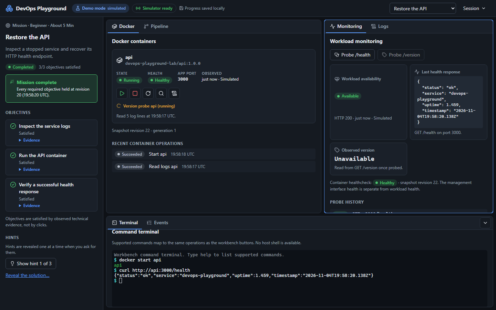
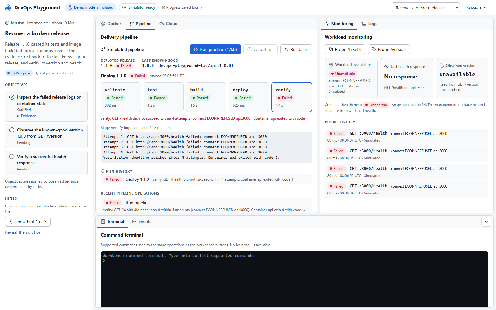
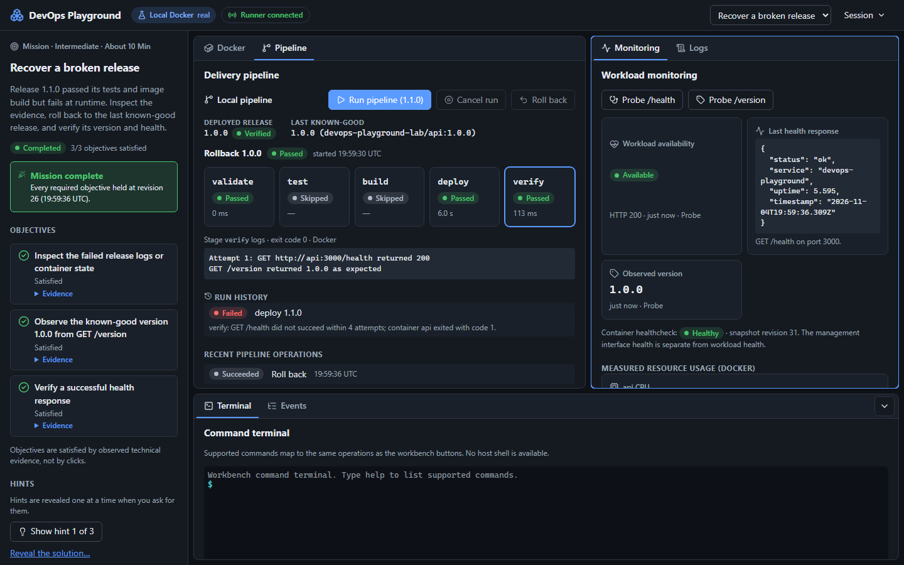

<h1 align="center">DevOps Playground</h1>

<p align="center">
  <a href="https://github.com/Nadjide/devops-playground/actions/workflows/ci.yml">
    
  </a>
</p>

<p align="center">
  
  
  
  
  
</p>

DevOps Playground is an interactive workbench for deploying, observing,
diagnosing, and recovering a small API. You operate the service through
connected Docker, logs, terminal, monitoring, and pipeline panels to complete
missions whose objectives are satisfied only by observed technical evidence.

It runs two ways: a **browser demo** that simulates everything with no backend,
and a **Local Docker mode** where an isolated runner operates real containers on
your machine. The original Express API from this repository is the workload
being operated.



## What It Demonstrates

- A workbench where Docker, cloud storage, logs, terminal, monitoring, and pipeline panels share one session state and one event stream.
- A shared domain engine: validated contracts, a pure reducer, idempotent and serialized operations, bounded history, and generation-safe resets.
- Evidence-based missions: objectives pass only on fresh observations (a running container, a real `200` from `/health`, the expected version), never on clicks.
- A real local delivery chain: tests in a disposable container, image builds through the Engine API, deploy, verify, and rollback.
- Security boundaries: a socket-holding runner without published ports, per-launch tokens, same-origin and CSRF protection, ownership labels on every resource, and a validated command grammar instead of a shell.
- Recovery: versioned browser checkpoints, controller-restart recovery from label-verified resources, and scoped cleanup.
- Verification: unit, API, Docker integration, and Playwright suites that state whether they are simulated or real.

## Modes

| Mode | Start | What actually runs | Needs |
| --- | --- | --- | --- |
| Browser demo | `npm run dev:playground` or any static host for `apps/web/dist` | A deterministic simulator in the browser; every observation is labeled Simulated | Node.js 22 to build |
| Packaged demo | `npm run playground:demo` | The same demo served by the control portal on `127.0.0.1:3001`; no runner, no Docker socket | Docker |
| Local Docker | `npm run playground:local` | Real containers, networks, logs, probes, builds, and metrics through the internal runner | Docker with Linux containers |

The mode is always visible in the top bar, and every observation carries its
source (Simulated, Docker, or Probe). Local Docker never falls back to simulation.

## Quickstart

Prerequisites: Node.js 22.18 or later, npm, and for the packaged modes Docker
Desktop or Docker Engine with the Compose v2 plugin.

```bash
git clone https://github.com/Nadjide/devops-playground.git
cd devops-playground
npm ci
```

Browser demo with hot reload (prints its URL, `http://127.0.0.1:5173` by default):

```bash
npm run dev:playground
```

Real local Docker lab on `http://127.0.0.1:3001` (the first start builds the images):

```bash
npm run playground:local
```

Stop it and remove everything it created:

```bash
npm run playground:down
```

Set `PLAYGROUND_PORT` to use another loopback port.

## Missions

| Mission | Starting state | You must prove |
| --- | --- | --- |
| Restore the API | The known-good API was stopped cleanly | You read the evidence, the container runs, and `/health` answers `200` for this process |
| Fix a port configuration | The API listens on 3001 while probes expect 3000 | The workload runs with `appPort` 3000 and health succeeds on port 3000 |
| Recover a broken release | Release 1.1.0 passed tests and build but crashes at startup | You inspected the failure and the service again reports version `1.0.0` and healthy |
| Provision storage for a service (AWS S3 or Azure Blob) | The reports service writes to a bucket or container that does not exist | It exists, you wrote and read an object back, and the service's own storage check round-trips its payload |
| Repair a storage configuration (AWS S3 or Azure Blob) | The service points at a misspelled bucket or container | The service uses the namespace that holds its data and a fresh storage check passes |
| Free exploration | Any approved fixture | Nothing: operate, configure, run the pipeline, break, and recover |

Hints are revealed one at a time; the solution appears only after an explicit,
confirmed request. Completion is recorded at the revision where every required
objective held, and stays recorded if the service later degrades.

### First mission walkthrough

1. Open the workbench: the API container is stopped.
2. Read its logs: open the Logs panel (or run `docker logs api` in the terminal) and find the graceful shutdown.
3. Start the container (`docker start api` or the start button) and watch it become healthy.
4. Probe `/health` from Monitoring or with `curl http://api:3000/health`.
5. The mission completes and every objective shows its evidence.



## Local Docker Mode



```bash
npm run playground:local     # start portal and runner
npm run playground:status    # controller, runner, Docker, owned resources
npm run playground:down      # end sessions, stop the stack, report leftovers
npm run playground:cleanup   # remove only resources owned by this installation
```

Each session gets its own internal network and constrained container (non-root,
read-only root filesystem, 256 MiB, 0.5 CPU, 128 processes, no capabilities, no
published ports). Probes reach only the session's service alias on the lab's
expected port. If the controller restarts, the workbench offers to recover the
session from label-verified resources or to clean them up.

**Trust note:** the runner mounts the Docker socket, which controls the host
daemon. Use Local Docker mode only on your own machine. The public-facing mode
is the browser demo.

## Architecture

```text
Browser workbench (React)
  ├─ Demo mode: lab runtime + simulator in the browser (no network)
  └─ Local mode: control API on 127.0.0.1 (same origin, CSRF, SSE)
                   └─ runner on a private network (token, no ports)
                        └─ Docker Engine → labeled lab networks and containers
```

| Path | Role |
| --- | --- |
| `packages/lab-core` | Contracts, reducer, lab runtime, simulator, missions, pipeline recorder, command parser, checkpoints |
| `apps/web` | Workbench UI and the demo and local session clients |
| `apps/control` | Portal server and management API (sessions, operations, SSE, recovery) |
| `apps/runner` | The only Docker client: fixtures, lifecycle, probes, pipeline, metrics |
| `labs` | Lab manifests and the approved fixture workload |
| `scripts` | Launcher, stack checks, verification, screenshots, secret scan |
| `src`, `tests/app.test.js` | The original showcase API and its tests |

More detail: [workbench](apps/web/README.md), [domain package](packages/lab-core/README.md),
[control API](apps/control/README.md), [runner](apps/runner/README.md),
[labs](labs/README.md), and the [implementation plan](DEVOPS_PLAYGROUND_MASTER_PLAN.md).

## Original API

The original workload keeps its contracts and commands.

```bash
npm start                                 # http://localhost:3000
npm test
docker build -t devops-playground .
docker run -p 3000:3000 devops-playground
docker compose up --build
docker compose down
```

| Endpoint | Response |
| --- | --- |
| `GET /` | `{ "message": "DevOps Playground API is running" }` |
| `GET /health` | `{ "status": "ok", "service": "devops-playground", "uptime": 12.345, "timestamp": "…" }` |
| `GET /version` | `{ "name": "devops-playground", "version": "1.0.0", "environment": "development" }` |

## Tests and CI

```bash
npm run lint
npm run test:playground          # domain, workbench, control, runner unit and API tests
npm run test:e2e:demo            # Playwright against the static demo, backend blocked
npm run test:integration:local   # real Docker: missions, pipeline, recovery, security
npm run test:e2e:local           # Playwright against real Docker
npm run verify:playground        # every core gate with an acceptance report
```

GitHub Actions runs four jobs on every pull request: `Test` (lint and unit
suites), `Demo E2E` (simulated browser suite), `Playground stack` (packaged
modes, real Docker integration, local browser suite), and `Docker` (the
original image and Compose healthcheck). Job summaries separate simulated and
real Docker results. See the [verification matrix](tests/README.md).

## Troubleshooting

| Symptom | Cause and fix |
| --- | --- |
| `The Docker daemon is unavailable` from the launcher | Start Docker Desktop or Docker Engine, then rerun the command |
| Local diagnostics show `DOCKER_PERMISSION_DENIED` | The runner cannot use the socket; restart with `npm run playground:local` so the socket group is detected again |
| `DOCKER_CONTEXT_UNSUPPORTED` | Switch Docker Desktop to Linux containers |
| `Port 3001 on 127.0.0.1 is already in use` | Stop the other process or set `PLAYGROUND_PORT` |
| The first local session takes a minute | The approved fixture image is being built; later sessions reuse it |
| A pipeline image build fails | Check network access for the `node:22-alpine` base image, then run the pipeline again |
| Health probes fail with `ECONNREFUSED` | Often the mission incident itself (stopped service, wrong port, crashed release); read the logs |
| Workbench shows Reconnecting | The event stream dropped; it resumes from the last event or refreshes the snapshot automatically |
| Saved demo progress cannot be restored | Choose Discard saved progress or Continue without saving in the banner |
| Owned resources remain after an interruption | `npm run playground:status`, then `npm run playground:cleanup` |

Lab incidents (a stopped API, a wrong port, a crashing release) are expected
mission states, not installation problems.

## Supported Environments and Limitations

- Verified on Windows 11 with Docker Desktop (Engine 29.7.2, Compose 5.4.0) and on Ubuntu GitHub Actions runners.
- macOS, rootless Docker, and remote Docker contexts are not verified.
- One local session runs at a time; the workbench is single-user by design.
- The storage missions run in the browser demo against simulated, session-scoped AWS S3 and Azure Blob storage; they never contact a cloud account. Local emulator execution is planned in later lots.
- Nothing is published automatically: hosting the demo or tagging a release is an explicit owner decision.

## Why This Project Exists

This repository started as a small but real DevOps showcase: an API with tests,
a Docker image, Compose, and CI. The playground turns it into something you can
operate, break, and recover, and makes every claim inspectable in code and in
its test suites.

It supports the positioning of Nadjide Omar as a Full Stack developer with a
strong DevOps mindset: Full Stack Development · DevOps · CI/CD · Docker · API ·
Cloud · Architecture.
